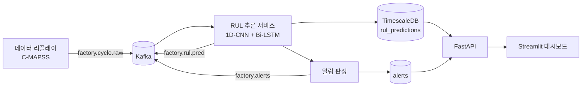

# 진동·센서 스트림 기반 예지보전(PdM) 관제 시스템

Kafka와 TimescaleDB로 센서 스트림을 수집하고, 딥러닝 모델로 설비 잔여수명(RUL)을 예측해 알림과 대시보드로 보여 주는 **End-to-End 예지보전 파이프라인**입니다. 공개 벤치마크 데이터(CWRU, NASA IMS, NASA C-MAPSS)로 구현하고 검증했습니다.

> 시연 영상: (YouTube 링크 추가)
> 발표 자료: [`docs/PdM_관제시스템_발표.pptx`](docs/PdM_관제시스템_발표.pptx)


## 목차
- [구현 현황](#구현-현황)
- [시스템 구조](#시스템-구조)
- [기술 스택](#기술-스택)
- [데이터셋](#데이터셋)
- [결과](#결과)
- [프로젝트 구조](#프로젝트-구조)
- [시작하기](#시작하기)
- [API](#api)
- [알림 규칙](#알림-규칙)
- [한계와 향후 과제](#한계와-향후-과제)

## 구현 현황

이 프로젝트는 **오프라인 검증(Colab)** 과 **실시간 서비스(VS Code)** 로 나뉩니다. 서비스에 연결된 것은 C-MAPSS의 RUL 예측뿐이고, 베어링 진동 판단은 Colab에서 검증까지만 했습니다.

| 기능 | 데이터셋 | Colab 검증 | 서비스 연결 |
|---|---|---|---|
| 특징 추출 (FFT · 엔벨로프) | CWRU, IMS | ✅ | ⬜ |
| 베어링 결함 유형 분류 (RF · XGBoost) | CWRU | ✅ | ⬜ |
| 이상 감지 · Health Index (PCA · Autoencoder) | IMS | ✅ | ⬜ |
| 잔여수명(RUL) 예측 (1D-CNN + Bi-LSTM) | C-MAPSS | ✅ | ✅ |
| Kafka 스트리밍 · TimescaleDB 저장 | - | - | ✅ |
| 알림 판정·기록 · 관제 대시보드 | - | - | ✅ |

## 시스템 구조



- 엔진 ID를 Kafka 메시지 키로 써서 같은 엔진의 데이터 순서를 보장합니다.
- DB 저장에 성공한 뒤에 Kafka 오프셋을 커밋합니다(at-least-once).
- 엔진별로 30사이클 윈도우를 메모리에 유지하며, 오래 데이터가 없는 엔진은 주기적으로 정리합니다.
- 기존 가상 센서 파이프라인(`factory.sensor.raw` → `sensor_readings`)은 그대로 두었고, `.env`로 켜고 끌 수 있습니다.

## 기술 스택

| 분야 | 사용 기술 |
|---|---|
| 언어 · 환경 | Python, VS Code, Google Colab |
| 데이터 처리 | pandas, NumPy, SciPy (Hanning 윈도우 FFT, Hilbert 엔벨로프) |
| 머신러닝 · 딥러닝 | scikit-learn, XGBoost, PyTorch |
| 스트리밍 · 저장 | Apache Kafka 3.7, TimescaleDB (PostgreSQL 14), Docker Compose |
| 백엔드 | FastAPI, aiokafka, asyncpg |
| 대시보드 | Streamlit, Plotly |

## 데이터셋

원본 데이터는 용량 때문에 저장소에 포함하지 않았습니다. 아래 공식 출처에서 내려받아 배치하세요.

| 데이터셋 | 용도 | 사용한 부분 |
|---|---|---|
| CWRU Bearing Data Center | 결함 유형 분류 | 12kHz Drive End, 결함 0.007 · 0.021인치, 부하 0HP · 3HP |
| NASA IMS Bearings (University of Cincinnati) | 이상 감지, Health Index | Set 2 (2nd_test): 984파일, 20,480Hz, 약 164시간, 베어링 1 외륜 결함으로 고장 |
| NASA C-MAPSS (Turbofan Engine Degradation) | RUL 예측 | FD001 (train · test · RUL, 엔진 100대) |

```
data/                       # .gitignore 대상
├── cmapss/  train_FD001.txt  test_FD001.txt  RUL_FD001.txt
├── ims/2nd_test/           # 파일 984개
└── cwru/    97.mat 105.mat 118.mat 130.mat 209.mat 222.mat 234.mat ...
```

CWRU 파일 번호(12kHz Drive End): 정상 `97`, 0.007인치 내륜 `105` · 볼 `118` · 외륜(6시) `130`, 0.021인치 내륜 `209` · 볼 `222` · 외륜 `234`. 3HP 파일은 `.mat` 안의 RPM(약 1730)으로 확인하세요.

## 결과

### C-MAPSS FD001 · RUL 예측 (1D-CNN + Bi-LSTM)
30사이클 윈도우, 센서 14개, RUL 상한 125, 엔진 단위 검증 분할(80/20). 테스트는 엔진별 마지막 윈도우를 `RUL_FD001.txt`와 비교합니다.

| 모델 | RMSE (정답 125 클리핑) | RMSE (원본 정답) | NASA Score |
|---|---|---|---|
| Random Forest (베이스라인) | 17.86 | 19.17 | 995 |
| **1D-CNN + Bi-LSTM** (5-시드 평균) | **12.98 ± 0.56** | **14.54 ± 0.55** | **325 ± 24** |

**스트리밍 재현 검증**: 테스트 데이터 13,096건을 Kafka로 전송하면 엔진 100대에서 예측 10,196건이 저장되었습니다(엔진당 처음 29사이클은 윈도우 수집). 서버 경로의 RMSE는 12.51 / 14.13으로 노트북 평가와 같은 수준이며, 서비스에 올린 모델은 시드 42 단일 모델입니다.

### CWRU · 결함 유형 분류
2048샘플 윈도우(50% 겹침), 특징 28개. 0HP로 학습하고 3HP로 테스트(827윈도우)한 Random Forest의 정확도는 1.00입니다. **CWRU는 쉬운 벤치마크라서 높은 점수가 모델의 우수성을 뜻하지는 않습니다.**

### IMS · 이상 감지와 Health Index
처음 25%(약 41시간)의 정상 구간만으로 학습하고 베어링 1~4를 모두 평가했습니다.

| 방법 | Spearman | 단조성 | 첫 경보(h) | 리드타임(h) |
|---|---|---|---|---|
| Mahalanobis | −0.885 | 0.398 | 90.3 | 73.5 |
| PCA-SPE | −0.883 | 0.148 | 96.2 | 67.7 |
| **Autoencoder** | **−0.890** | **0.459** | **90.0** | **73.8** |
| Fusion (AE+PCA) | −0.892 | 0.360 | 91.5 | 72.3 |

방법 간 차이가 작고 고장 사례가 1건뿐이라 "Autoencoder가 월등하다"고 결론 내리지 않습니다. 베어링 2~4의 후반부 하락은 모델 오판이 아니라 고장 신호가 전달된 것일 수 있으나, 확인하지 못한 가설입니다.


## 프로젝트 구조

```
smart_Factory/
├── main.py                    # FastAPI 앱 (lifespan에서 서비스 시작)
├── docker-compose.yml         # Kafka, TimescaleDB
├── requirements.txt
├── .env.example
├── api/                       # replay.py, rul.py, alerts.py
├── config/                    # settings.py
├── core/
│   ├── producer.py  consumer.py          # 가상 센서 파이프라인
│   ├── replay_producer.py  replay_service.py   # 실제 데이터 리플레이
│   ├── rul_service.py  inference_worker.py     # RUL 추론 (서버 내장 / 단독 실행)
│   └── alert_engine.py                   # 알림 판정
├── ml/                        # window.py, rul_model.py, artifacts/(모델 가중치·설정)
├── models/                    # database.py, rul_repository.py, alert_repository.py
├── dashboard/                 # app.py, charts.py, logic.py
├── notebooks/
│   ├── pdm_feature_extraction.ipynb   # CWRU·IMS·C-MAPSS 특징 추출, CWRU 분류
│   ├── pdm_rul_model.ipynb            # C-MAPSS RUL 모델 학습·평가
│   └── pdm_ims_autoencoder.ipynb      # IMS 4채널 이상 감지·Health Index
├── docs/                      # 발표 자료, 이미지
└── tests/
```

## 시작하기

### 1. 준비
- Python 3.10 이상, Docker Desktop
- 데이터를 위 [데이터셋](#데이터셋) 구조로 배치

```powershell
python -m venv venv
venv\Scripts\activate
pip install -r requirements.txt
# CPU 전용 PyTorch (추론용)
pip install torch --index-url https://download.pytorch.org/whl/cpu
```

### 2. 모델 파일 배치
`notebooks/pdm_rul_model.ipynb`를 Colab에서 실행하면 Drive의 `models/`에 `rul_cnn_bilstm_fd001.pt`와 `rul_meta_fd001.json`이 생성됩니다. 두 파일을 `ml/artifacts/`에 복사하세요.

### 3. 환경 변수
`.env.example`을 `.env`로 복사한 뒤 값을 채웁니다.

| 변수 | 설명 | 기본값 |
|---|---|---|
| `KAFKA_BOOTSTRAP_SERVERS` | Kafka 주소 | `localhost:9092` |
| `DB_HOST` `DB_PORT` `DB_USER` `DB_PASSWORD` `DB_NAME` | TimescaleDB 접속 정보 | - |
| `ENABLE_VIRTUAL_DATA` | 가상 센서 파이프라인 사용 | `true` |
| `ENABLE_RUL_SERVICE` | RUL 추론 서비스 사용 | `true` |
| `CMAPSS_DATA_DIR` | C-MAPSS 폴더 경로(리플레이용) | - |
| `IMS_DATA_DIR` | IMS 폴더 경로 | - |
| `ALERT_WARN_HI` `ALERT_CRIT_HI` `ALERT_HYSTERESIS` | 알림 기준 (Health Index) | `60` `30` `5` |
| `ENGINE_IDLE_PRUNE_SEC` | 데이터가 없는 엔진 상태 정리 기준(초) | `3600` |

### 4. 실행
```powershell
docker compose up -d          # Kafka, TimescaleDB
uvicorn main:app              # API 서버 (--reload는 모델 로딩이 반복되어 비권장)
streamlit run dashboard/app.py    # 새 터미널, http://localhost:8501
```

대시보드 사이드바에서 **▶ 시작**을 누르면 C-MAPSS 테스트 데이터가 Kafka로 전송되고, 예측·알림·화면이 갱신됩니다. 속도를 "빠름"으로 하면 1~2분 안에 한 바퀴가 끝납니다. 다시 돌리기 전에는 **DB 초기화**를 먼저 실행하세요(데이터가 중복됩니다).
서버 안의 RUL 서비스와 `python -m core.inference_worker`를 **동시에 실행하지 마세요**(같은 컨슈머 그룹이 메시지를 나눠 가집니다).

### 5. Colab 노트북
노트북은 Google Drive의 `MyDrive/pdm_project/` 아래에 `cwru/`, `ims/2nd_test/`, `cmapss/`, `features/`, `models/` 폴더가 있다고 가정합니다. 경로가 다르면 첫 셀의 `BASE`를 수정하세요.

### 문제 해결
- `pyarrow requires NumPy 2.0 or newer`: NumPy 1.x 환경에서 발생합니다. `pip install "pyarrow<16"`으로 낮추면 해결됩니다.

## API

| 메서드 | 경로 | 설명 |
|---|---|---|
| GET | `/` | 서버·서비스 상태 |
| POST | `/api/v1/replay/start` | 리플레이 시작 `{"kind":"cycle","interval":0.05,"loop":false}` |
| POST | `/api/v1/replay/stop` · GET `/status` | 중지 · 진행 상태 |
| POST | `/api/v1/replay/reset?confirm=true` | 예측과 알림 삭제 |
| GET | `/api/v1/rul/latest` | 엔진별 최신 예측 |
| GET | `/api/v1/rul/history/{asset_id}` | 엔진별 이력 |
| GET | `/api/v1/rul/summary` · `/warmup` | 요약 · 윈도우 수집 중인 엔진 |
| GET | `/api/v1/alerts` · `/summary` · `/config` | 알림 목록 · 요약 · 기준값 |
| POST | `/api/v1/alerts/{id}/ack` · `/ack-all` | 알림 확인 처리 |

실행 후 `http://localhost:8000/docs`에서 직접 호출해 볼 수 있습니다.

## 알림 규칙

Health Index = 예측 RUL ÷ 125 × 100 (C-MAPSS 기준)입니다.

- **주의**: Health Index 60 미만 (예상 잔여 약 75사이클)
- **긴급**: Health Index 30 미만 (약 37사이클)
- 단계가 **올라가는 순간에만** 기록합니다(같은 단계에 머무는 동안은 기록 없음).
- 한 번 올라간 단계는 기준 + 5 이상 회복해야 내려갑니다(히스테리시스). 경계에서 값이 흔들려도 알림이 반복되지 않습니다.
- 테스트 데이터 한 바퀴 기준 긴급 29건, 주의 60건이 기록됩니다.
- 알림은 DB(`alerts`)와 Kafka 토픽(`factory.alerts`)에 모두 저장·발행됩니다.

## 한계와 향후 과제

**한계**
- IMS는 고장이 1건이라 일반화를 주장할 수 없습니다.
- CWRU의 1.00은 쉬운 벤치마크의 결과입니다.
- RUL 단위는 사이클이며, 대시보드의 시간 환산은 표시용 가정값입니다.
- 두 가지 Health Index(C-MAPSS는 예측 RUL 기반, IMS는 이상 점수 기반)를 쓰며 서로 직접 비교할 수 없습니다.
- 베어링 진동 판단(분류·이상 감지)은 서비스에 연결되지 않았습니다.
- 처리량·지연 시간은 측정하지 않았고, 리플레이로 구조만 검증했습니다.

**향후 추가 기능**
- 진동 서비스화: DSP 워커(FFT·엔벨로프), 분류기와 Autoencoder 서버 연동, 실시간 스펙트로그램, 베어링 4대 동시 모니터링
- AI 에이전트(LangGraph): 탐지 → 매뉴얼 RAG 검색 → Slack 알림 → 결과 검증
- Weibull 생존 분석과 신뢰구간, 실제 시간 단위 RUL
- 1D-CNN 원신호 분류, 모터·기어 부위 분류, 다중 운전조건(FD002~FD004)
- 외부 알림 채널, 설비 종류별 모델·임계값, 최신 상태 전용 테이블, 워커 재시작 시 윈도우 복구

## 출처

- CWRU Bearing Data Center, Case Western Reserve University
- NASA Prognostics Data Repository: IMS Bearing Data Set (University of Cincinnati), C-MAPSS Turbofan Engine Degradation Simulation Data Set# FDS-project
